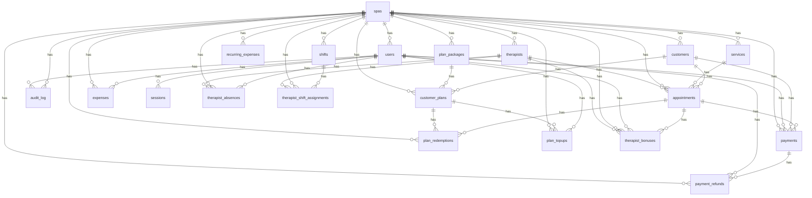

# Database schema

PostgreSQL, schema `spa` (`SPA_PG_SCHEMA`). Generated by `python tools/schema_doc.py` from the live catalog -
do not edit by hand; change a `migrations/NNN_*.sql` file and regenerate. Raw DDL: [`sql/schema.sql`](../sql/schema.sql).

## Relationships

| Table | Purpose |
|---|---|
| [`appointments`](#appointments) | One booking of one customer with one therapist for one service. Completed appointments drive revenue and incentive. |
| [`audit_log`](#audit_log) | Append-only record of every successful change made through the API; never edited or deleted by the app. |
| [`customer_plans`](#customer_plans) | Prepaid package owned by one customer in one spa. A balance is measured in hours or INR. |
| [`customers`](#customers) | Spa clients, created by onboarding or by hand. |
| [`expenses`](#expenses) | One-off spa costs on a given date. |
| [`payment_refunds`](#payment_refunds) | Immutable partial or full refunds against recorded appointment payments. |
| [`payments`](#payments) | Amounts collected from customers against appointments; multiple partial payments are allowed. |
| [`plan_packages`](#plan_packages) | Plans a spa sells at a fixed price; staff assign them to customers. |
| [`plan_redemptions`](#plan_redemptions) | Auditable deductions from prepaid customer plans for completed appointments; reversal restores the balance. |
| [`plan_topups`](#plan_topups) | Amounts added to an existing prepaid plan after it was sold. |
| [`recurring_expenses`](#recurring_expenses) | A cost charged every month on a fixed day (rent, electricity, internet...), counted in each month it is active. |
| [`services`](#services) | Price list of treatments. Editing a price affects future bookings only. |
| [`sessions`](#sessions) | Login sessions as opaque bearer tokens. Only the SHA-256 fingerprint of a token is stored, so a database leak cannot be replayed. |
| [`shifts`](#shifts) | Reusable daily work-time window for a spa. |
| [`spas`](#spas) | Each spa (business) using the system. Its admins and staff see only its data; a superadmin sees every spa. |
| [`therapist_absences`](#therapist_absences) | Days a therapist was away; attendance counts scheduled shift days minus these. |
| [`therapist_bonuses`](#therapist_bonuses) | Extra incentives for a therapist on a date, added to that month's payslip on top of the percentage incentive. |
| [`therapist_shift_assignments`](#therapist_shift_assignments) | Weekly therapist roster; one shift per weekday. Monday=0 through Sunday=6. |
| [`therapists`](#therapists) | Staff who perform services and are paid on payslips. Never deleted, only set inactive, so past payslips stay reproducible. |
| [`users`](#users) | Staff logins. Role admin = everything; staff = customers, onboarding, appointments. |

## appointments

One booking of one customer with one therapist for one service. Completed appointments drive revenue and incentive.

| Column | Type | Null | Default | Description |
|---|---|---|---|---|
| `id` | bigint | no | identity | Surrogate key. |
| `customer_id` | bigint | no |  | Who is being treated. Customers are never deleted, so history stays intact. |
| `therapist_id` | bigint | no |  | Who performs it; also the key of the no-overlap constraint. |
| `service_id` | bigint | no |  | What is performed. |
| `start_at` | timestamp without time zone | no |  | Spa-local wall-clock time (no time zone). |
| `duration_min` | integer | no |  | Copied from the service at booking time. |
| `end_at` | timestamp without time zone | yes | generated: `(start_at + make_interval(mins => duration_min))` | Generated: start_at + duration_min. Used by the no-overlap constraint. |
| `price` | numeric(12,2) | no |  | Amount agreed at booking in INR (list price unless overridden). Frozen: later price edits never change it. Payroll uses this. |
| `status` | text | no | `'booked'::text` | booked -> completed / cancelled / no_show. Only completed counts for revenue and incentive; only booked can be edited. |
| `notes` | text | yes |  | Free-text note for this visit. |
| `created_at` | timestamp with time zone | no | `now()` | When it was booked. |
| `updated_at` | timestamp with time zone | no | `now()` | Last reschedule or status change. |
| `spa_id` | bigint | no |  | The spa of the booking; always that of its customer, therapist and service. |

**Constraints**

- Check `appointments_duration_min_check`: `CHECK ((duration_min > 0))`
- Check `appointments_price_check`: `CHECK ((price >= (0)::numeric))`
- Check `appointments_status_check`: `CHECK ((status = ANY (ARRAY['booked'::text, 'completed'::text, 'cancelled'::text, 'no_show'::text])))`
- Foreign key `appointments_customer_id_fkey`: `FOREIGN KEY (customer_id) REFERENCES customers(id)`
- Foreign key `appointments_service_id_fkey`: `FOREIGN KEY (service_id) REFERENCES services(id)`
- Foreign key `appointments_spa_id_fkey`: `FOREIGN KEY (spa_id) REFERENCES spas(id)`
- Foreign key `appointments_therapist_id_fkey`: `FOREIGN KEY (therapist_id) REFERENCES therapists(id)`
- Primary key `appointments_pkey`: `PRIMARY KEY (id)`
- Exclusion `appointments_no_overlap`: `EXCLUDE USING gist (therapist_id WITH =, tsrange(start_at, end_at) WITH &&) WHERE ((status = ANY (ARRAY['booked'::text, 'completed'::text])))` - A therapist cannot have two booked/completed appointments whose time ranges overlap (back-to-back is allowed). Enforced by the database so concurrent requests cannot double-book.

**Indexes**

- `appointments_customer_idx`: `CREATE INDEX appointments_customer_idx ON appointments USING btree (customer_id, start_at DESC)`
- `appointments_no_overlap`: `CREATE INDEX appointments_no_overlap ON appointments USING gist (therapist_id, tsrange(start_at, end_at)) WHERE (status = ANY (ARRAY['booked'::text, 'completed'::text]))`
- `appointments_spa_start_idx`: `CREATE INDEX appointments_spa_start_idx ON appointments USING btree (spa_id, start_at)`
- `appointments_start_idx`: `CREATE INDEX appointments_start_idx ON appointments USING btree (start_at)`
- `appointments_therapist_idx`: `CREATE INDEX appointments_therapist_idx ON appointments USING btree (therapist_id, start_at)`

## audit_log

Append-only record of every successful change made through the API; never edited or deleted by the app.

| Column | Type | Null | Default | Description |
|---|---|---|---|---|
| `id` | bigint | no | identity | Identity. |
| `at` | timestamp with time zone | no | `now()` | When the change happened. |
| `spa_id` | bigint | yes |  | Spa the change was made in (NULL for superadmin-wide actions). |
| `user_id` | bigint | yes |  | Login that made the change. |
| `username` | text | yes |  | Username at the time, kept even if the login is renamed. |
| `role` | text | yes |  | Role at the time (superadmin, admin, staff). |
| `action` | text | no |  | Readable action, e.g. "Refund payment", "Edit service". |
| `method` | text | no |  | HTTP method (POST, PUT, PATCH, DELETE). |
| `path` | text | no |  | API path, with record ids. |
| `status` | smallint | no |  | HTTP status returned. |
| `details` | jsonb | yes |  | Request body with passwords and tokens removed. |
| `ip` | text | yes |  | Client address as seen by the API. |

**Constraints**

- Foreign key `audit_log_spa_id_fkey`: `FOREIGN KEY (spa_id) REFERENCES spas(id)`
- Foreign key `audit_log_user_id_fkey`: `FOREIGN KEY (user_id) REFERENCES users(id)`
- Primary key `audit_log_pkey`: `PRIMARY KEY (id)`

**Indexes**

- `audit_log_spa_at_idx`: `CREATE INDEX audit_log_spa_at_idx ON audit_log USING btree (spa_id, at DESC)`
- `audit_log_user_at_idx`: `CREATE INDEX audit_log_user_at_idx ON audit_log USING btree (user_id, at DESC)`

## customer_plans

Prepaid package owned by one customer in one spa. A balance is measured in hours or INR.

| Column | Type | Null | Default | Description |
|---|---|---|---|---|
| `id` | bigint | no | identity | Identity. |
| `customer_id` | bigint | no |  | Customer who purchased this plan. |
| `spa_id` | bigint | no |  | Owning spa; must match the customer and appointment. |
| `name` | text | no |  | Display name of the prepaid package. |
| `plan_type` | text | no |  | Balance unit: hours for service time, or rupees for service value. |
| `purchased_amount` | numeric(12,2) | no |  | Original amount purchased, in the plan unit. |
| `balance` | numeric(12,2) | no |  | Remaining amount, in the plan unit; reduced only when an appointment is completed. |
| `expires_on` | date | yes |  | Optional last date on which this plan can be redeemed. |
| `notes` | text | yes |  | Optional purchase or package notes. |
| `created_at` | timestamp with time zone | no | `now()` | When the plan was added to the customer. |
| `price_paid` | numeric(12,2) | yes |  | Money received when the plan was sold (INR); counted as revenue on the sale date. |
| `paid_at` | timestamp with time zone | yes |  | When the plan cost was received; NULL = payment pending. Plan sales count on this date. |
| `package_id` | bigint | yes |  | Package the plan was assigned from; NULL = custom plan made by an admin. |
| `payment_method` | text | yes |  | How the plan cost was paid (cash, upi, card, bank_transfer, other); NULL while pending. |

**Constraints**

- Check `customer_plans_check`: `CHECK (((balance >= (0)::numeric) AND (balance <= purchased_amount)))`
- Check `customer_plans_name_check`: `CHECK ((length(btrim(name)) > 0))`
- Check `customer_plans_payment_method_check`: `CHECK ((payment_method = ANY (ARRAY['cash'::text, 'upi'::text, 'card'::text, 'bank_transfer'::text, 'other'::text])))`
- Check `customer_plans_plan_type_check`: `CHECK ((plan_type = ANY (ARRAY['hours'::text, 'rupees'::text])))`
- Check `customer_plans_price_paid_check`: `CHECK ((price_paid >= (0)::numeric))`
- Check `customer_plans_purchased_amount_check`: `CHECK ((purchased_amount > (0)::numeric))`
- Foreign key `customer_plans_customer_id_fkey`: `FOREIGN KEY (customer_id) REFERENCES customers(id)`
- Foreign key `customer_plans_package_id_fkey`: `FOREIGN KEY (package_id) REFERENCES plan_packages(id)`
- Foreign key `customer_plans_spa_id_fkey`: `FOREIGN KEY (spa_id) REFERENCES spas(id)`
- Primary key `customer_plans_pkey`: `PRIMARY KEY (id)`

**Indexes**

- `customer_plans_customer_idx`: `CREATE INDEX customer_plans_customer_idx ON customer_plans USING btree (spa_id, customer_id, created_at)`

## customers

Spa clients, created by onboarding or by hand.

| Column | Type | Null | Default | Description |
|---|---|---|---|---|
| `id` | bigint | no | identity | Surrogate key. |
| `name` | text | no |  | Full name; must not be blank. |
| `phone` | text | no |  | Unique across customers (customers_phone_key); how reception finds a returning client. |
| `email` | text | yes |  | Optional contact email. |
| `gender` | text | yes |  | Free text; the UI offers Female, Male, Other. |
| `dob` | date | yes |  | Date of birth (optional). |
| `address` | text | yes |  | Optional postal address. |
| `notes` | text | yes |  | Allergies, skin type, preferences. |
| `created_at` | timestamp with time zone | no | `now()` | Onboarding time; the "new customers" report counts by it in the spa time zone. |
| `updated_at` | timestamp with time zone | no | `now()` | Last edit. |
| `spa_id` | bigint | no |  | The spa this customer belongs to; phone is unique within it (customers_phone_key). |
| `preferred_payment_method` | text | yes |  | Optional default payment method preference; each payment records its actual method independently. |

**Constraints**

- Check `customers_name_check`: `CHECK ((length(btrim(name)) > 0))`
- Check `customers_preferred_payment_method_check`: `CHECK (((preferred_payment_method IS NULL) OR (preferred_payment_method = ANY (ARRAY['cash'::text, 'upi'::text, 'card'::text, 'bank_transfer'::text, 'other'::text]))))`
- Foreign key `customers_spa_id_fkey`: `FOREIGN KEY (spa_id) REFERENCES spas(id)`
- Primary key `customers_pkey`: `PRIMARY KEY (id)`
- Unique `customers_phone_key`: `UNIQUE (spa_id, phone)`

**Indexes**

- `customers_name_idx`: `CREATE INDEX customers_name_idx ON customers USING btree (lower(name))`
- `customers_phone_key`: `CREATE UNIQUE INDEX customers_phone_key ON customers USING btree (spa_id, phone)`
- `customers_spa_idx`: `CREATE INDEX customers_spa_idx ON customers USING btree (spa_id, lower(name))`

## expenses

One-off spa costs on a given date.

| Column | Type | Null | Default | Description |
|---|---|---|---|---|
| `id` | bigint | no | identity | Identity. |
| `spa_id` | bigint | no |  | Owning spa. |
| `on_date` | date | no |  | Date the money was spent. |
| `category` | text | no | `'Other'::text` | Grouping for reports, e.g. Supplies, Repairs, Marketing. |
| `amount` | numeric(12,2) | no |  | Amount in INR. |
| `note` | text | yes |  | What it was for. |
| `created_by` | bigint | yes |  | Login that recorded it. |
| `created_at` | timestamp with time zone | no | `now()` | When it was recorded. |
| `payment_method` | text | yes |  | How the expense was paid (cash, upi, card, bank_transfer, other). |

**Constraints**

- Check `expenses_amount_check`: `CHECK ((amount > (0)::numeric))`
- Check `expenses_payment_method_check`: `CHECK ((payment_method = ANY (ARRAY['cash'::text, 'upi'::text, 'card'::text, 'bank_transfer'::text, 'other'::text])))`
- Foreign key `expenses_created_by_fkey`: `FOREIGN KEY (created_by) REFERENCES users(id)`
- Foreign key `expenses_spa_id_fkey`: `FOREIGN KEY (spa_id) REFERENCES spas(id)`
- Primary key `expenses_pkey`: `PRIMARY KEY (id)`

**Indexes**

- `expenses_spa_date_idx`: `CREATE INDEX expenses_spa_date_idx ON expenses USING btree (spa_id, on_date)`

## payment_refunds

Immutable partial or full refunds against recorded appointment payments.

| Column | Type | Null | Default | Description |
|---|---|---|---|---|
| `id` | bigint | no | identity | Identity. |
| `spa_id` | bigint | no |  | Owning spa for tenant isolation. |
| `payment_id` | bigint | no |  | Original payment being refunded. |
| `amount` | numeric(12,2) | no |  | Refunded amount in INR; cumulative refunds cannot exceed the payment. |
| `reason` | text | yes |  | Optional reason for the refund. |
| `refunded_by` | bigint | yes |  | Admin login that authorised the refund. |
| `refunded_at` | timestamp with time zone | no | `now()` | When the refund was recorded. |

**Constraints**

- Check `payment_refunds_amount_check`: `CHECK ((amount > (0)::numeric))`
- Foreign key `payment_refunds_payment_id_fkey`: `FOREIGN KEY (payment_id) REFERENCES payments(id)`
- Foreign key `payment_refunds_refunded_by_fkey`: `FOREIGN KEY (refunded_by) REFERENCES users(id)`
- Foreign key `payment_refunds_spa_id_fkey`: `FOREIGN KEY (spa_id) REFERENCES spas(id)`
- Primary key `payment_refunds_pkey`: `PRIMARY KEY (id)`

**Indexes**

- `payment_refunds_payment_idx`: `CREATE INDEX payment_refunds_payment_idx ON payment_refunds USING btree (spa_id, payment_id, refunded_at)`

## payments

Amounts collected from customers against appointments; multiple partial payments are allowed.

| Column | Type | Null | Default | Description |
|---|---|---|---|---|
| `id` | bigint | no | identity | Identity and receipt number source. |
| `spa_id` | bigint | no |  | Owning spa for tenant isolation. |
| `appointment_id` | bigint | no |  | Appointment this payment settles. |
| `customer_id` | bigint | no |  | Customer from whom payment was received. |
| `amount` | numeric(12,2) | no |  | Gross amount received in INR. |
| `method` | text | no |  | Collection method: cash, UPI, card, bank transfer, or other. |
| `reference` | text | yes |  | Optional transaction reference, e.g. UPI reference or card slip. |
| `note` | text | yes |  | Optional note entered by the cashier. |
| `received_by` | bigint | yes |  | Login that recorded the payment. |
| `received_at` | timestamp with time zone | no | `now()` | Local settlement timestamp for daily collection reports. |
| `created_at` | timestamp with time zone | no | `now()` | When the payment record was created. |

**Constraints**

- Check `payments_amount_check`: `CHECK ((amount > (0)::numeric))`
- Check `payments_method_check`: `CHECK ((method = ANY (ARRAY['cash'::text, 'upi'::text, 'card'::text, 'bank_transfer'::text, 'other'::text])))`
- Foreign key `payments_appointment_id_fkey`: `FOREIGN KEY (appointment_id) REFERENCES appointments(id)`
- Foreign key `payments_customer_id_fkey`: `FOREIGN KEY (customer_id) REFERENCES customers(id)`
- Foreign key `payments_received_by_fkey`: `FOREIGN KEY (received_by) REFERENCES users(id)`
- Foreign key `payments_spa_id_fkey`: `FOREIGN KEY (spa_id) REFERENCES spas(id)`
- Primary key `payments_pkey`: `PRIMARY KEY (id)`

**Indexes**

- `payments_appointment_idx`: `CREATE INDEX payments_appointment_idx ON payments USING btree (spa_id, appointment_id, received_at)`
- `payments_spa_received_idx`: `CREATE INDEX payments_spa_received_idx ON payments USING btree (spa_id, received_at DESC)`

## plan_packages

Plans a spa sells at a fixed price; staff assign them to customers.

| Column | Type | Null | Default | Description |
|---|---|---|---|---|
| `id` | bigint | no | identity | Identity. |
| `spa_id` | bigint | no |  | Owning spa. |
| `name` | text | no |  | Package name, e.g. 10 Hours Gold. |
| `plan_type` | text | no |  | hours or rupees, like customer_plans.plan_type. |
| `amount` | numeric(12,2) | no |  | Hours or rupees the customer gets. |
| `price` | numeric(12,2) | no |  | What the customer pays (INR). |
| `validity_days` | integer | yes |  | Days the plan stays valid after it is assigned; NULL = no expiry. |
| `is_active` | boolean | no | `true` | Inactive packages cannot be assigned; plans already sold are unaffected. |
| `created_at` | timestamp with time zone | no | `now()` | When the package was created. |

**Constraints**

- Check `plan_packages_amount_check`: `CHECK ((amount > (0)::numeric))`
- Check `plan_packages_name_check`: `CHECK ((length(btrim(name)) > 0))`
- Check `plan_packages_plan_type_check`: `CHECK ((plan_type = ANY (ARRAY['hours'::text, 'rupees'::text])))`
- Check `plan_packages_price_check`: `CHECK ((price >= (0)::numeric))`
- Check `plan_packages_validity_days_check`: `CHECK ((validity_days > 0))`
- Foreign key `plan_packages_spa_id_fkey`: `FOREIGN KEY (spa_id) REFERENCES spas(id)`
- Primary key `plan_packages_pkey`: `PRIMARY KEY (id)`

**Indexes**

- `plan_packages_spa_name_key`: `CREATE UNIQUE INDEX plan_packages_spa_name_key ON plan_packages USING btree (spa_id, lower(name))`

## plan_redemptions

Auditable deductions from prepaid customer plans for completed appointments; reversal restores the balance.

| Column | Type | Null | Default | Description |
|---|---|---|---|---|
| `id` | bigint | no | identity | Identity. |
| `plan_id` | bigint | no |  | The prepaid plan that paid for the appointment. |
| `appointment_id` | bigint | no |  | The completed appointment; only one active plan deduction per appointment. |
| `spa_id` | bigint | no |  | Owning spa for tenant isolation. |
| `amount` | numeric(12,2) | no |  | Amount deducted in the unit recorded alongside it. |
| `unit` | text | no |  | hours or rupees, matching the plan type. |
| `created_at` | timestamp with time zone | no | `now()` | When the appointment consumed the plan. |
| `reversed_at` | timestamp with time zone | yes |  | When a deduction was reversed because the appointment left completed status. |

**Constraints**

- Check `plan_redemptions_amount_check`: `CHECK ((amount > (0)::numeric))`
- Check `plan_redemptions_unit_check`: `CHECK ((unit = ANY (ARRAY['hours'::text, 'rupees'::text])))`
- Foreign key `plan_redemptions_appointment_id_fkey`: `FOREIGN KEY (appointment_id) REFERENCES appointments(id)`
- Foreign key `plan_redemptions_plan_id_fkey`: `FOREIGN KEY (plan_id) REFERENCES customer_plans(id)`
- Foreign key `plan_redemptions_spa_id_fkey`: `FOREIGN KEY (spa_id) REFERENCES spas(id)`
- Primary key `plan_redemptions_pkey`: `PRIMARY KEY (id)`

**Indexes**

- `plan_redemptions_one_active_appointment`: `CREATE UNIQUE INDEX plan_redemptions_one_active_appointment ON plan_redemptions USING btree (appointment_id) WHERE (reversed_at IS NULL)`
- `plan_redemptions_plan_idx`: `CREATE INDEX plan_redemptions_plan_idx ON plan_redemptions USING btree (plan_id, created_at)`

## plan_topups

Amounts added to an existing prepaid plan after it was sold.

| Column | Type | Null | Default | Description |
|---|---|---|---|---|
| `id` | bigint | no | identity | Identity. |
| `plan_id` | bigint | no |  | Plan that was topped up. |
| `spa_id` | bigint | no |  | Owning spa; same as the plan. |
| `amount` | numeric(12,2) | no |  | Amount added, in the plan unit (hours or rupees). |
| `note` | text | yes |  | Optional note, e.g. payment details. |
| `created_by` | bigint | yes |  | Login that added the top-up. |
| `created_at` | timestamp with time zone | no | `now()` | When the top-up was added. |
| `price_paid` | numeric(12,2) | yes |  | Money received for this top-up (INR); counted as revenue on the top-up date. |
| `paid_at` | timestamp with time zone | yes |  | When the top-up cost was received; NULL = payment pending. Plan sales count on this date. |
| `payment_method` | text | yes |  | How the top-up was paid (cash, upi, card, bank_transfer, other); NULL while pending. |

**Constraints**

- Check `plan_topups_amount_check`: `CHECK ((amount > (0)::numeric))`
- Check `plan_topups_payment_method_check`: `CHECK ((payment_method = ANY (ARRAY['cash'::text, 'upi'::text, 'card'::text, 'bank_transfer'::text, 'other'::text])))`
- Check `plan_topups_price_paid_check`: `CHECK ((price_paid >= (0)::numeric))`
- Foreign key `plan_topups_created_by_fkey`: `FOREIGN KEY (created_by) REFERENCES users(id)`
- Foreign key `plan_topups_plan_id_fkey`: `FOREIGN KEY (plan_id) REFERENCES customer_plans(id)`
- Foreign key `plan_topups_spa_id_fkey`: `FOREIGN KEY (spa_id) REFERENCES spas(id)`
- Primary key `plan_topups_pkey`: `PRIMARY KEY (id)`

**Indexes**

- `plan_topups_plan_idx`: `CREATE INDEX plan_topups_plan_idx ON plan_topups USING btree (plan_id, created_at)`
- `plan_topups_spa_time_idx`: `CREATE INDEX plan_topups_spa_time_idx ON plan_topups USING btree (spa_id, created_at)`

## recurring_expenses

A cost charged every month on a fixed day (rent, electricity, internet...), counted in each month it is active.

| Column | Type | Null | Default | Description |
|---|---|---|---|---|
| `id` | bigint | no | identity | Identity. |
| `spa_id` | bigint | no |  | Owning spa. |
| `name` | text | no |  | What the cost is, e.g. Shop rent. |
| `category` | text | no | `'Other'::text` | Grouping for reports, e.g. Rent, Utilities, Supplies. |
| `amount` | numeric(12,2) | no |  | Monthly amount in INR. |
| `day_of_month` | smallint | no | `1` | Day (1-28) it falls due each month. |
| `starts_on` | date | no |  | First date it applies; months before are not charged. |
| `ends_on` | date | yes |  | Last date it applies; NULL = ongoing. |
| `notes` | text | yes |  | Optional notes. |
| `created_at` | timestamp with time zone | no | `now()` | When it was added. |

**Constraints**

- Check `recurring_expenses_amount_check`: `CHECK ((amount > (0)::numeric))`
- Check `recurring_expenses_check`: `CHECK (((ends_on IS NULL) OR (ends_on >= starts_on)))`
- Check `recurring_expenses_day_of_month_check`: `CHECK (((day_of_month >= 1) AND (day_of_month <= 28)))`
- Check `recurring_expenses_name_check`: `CHECK ((length(btrim(name)) > 0))`
- Foreign key `recurring_expenses_spa_id_fkey`: `FOREIGN KEY (spa_id) REFERENCES spas(id)`
- Primary key `recurring_expenses_pkey`: `PRIMARY KEY (id)`

**Indexes**

- `recurring_expenses_spa_idx`: `CREATE INDEX recurring_expenses_spa_idx ON recurring_expenses USING btree (spa_id, starts_on)`

## services

Price list of treatments. Editing a price affects future bookings only.

| Column | Type | Null | Default | Description |
|---|---|---|---|---|
| `id` | bigint | no | identity | Surrogate key. |
| `name` | text | no |  | Treatment name; unique ignoring case (services_name_key). |
| `price` | numeric(12,2) | no |  | List price in INR, copied onto an appointment when it is booked. |
| `duration_min` | integer | no | `60` | Minutes a booking blocks on the therapist's calendar. |
| `is_active` | boolean | no | `true` | Inactive services cannot be booked; history keeps pointing at them. |
| `spa_id` | bigint | no |  | The spa offering this service; name is unique within it. |

**Constraints**

- Check `services_duration_min_check`: `CHECK ((duration_min > 0))`
- Check `services_name_check`: `CHECK ((length(btrim(name)) > 0))`
- Check `services_price_check`: `CHECK ((price >= (0)::numeric))`
- Foreign key `services_spa_id_fkey`: `FOREIGN KEY (spa_id) REFERENCES spas(id)`
- Primary key `services_pkey`: `PRIMARY KEY (id)`

**Indexes**

- `services_name_key`: `CREATE UNIQUE INDEX services_name_key ON services USING btree (spa_id, lower(name))`

## sessions

Login sessions as opaque bearer tokens. Only the SHA-256 fingerprint of a token is stored, so a database leak cannot be replayed.

| Column | Type | Null | Default | Description |
|---|---|---|---|---|
| `token_hash` | text | no |  | SHA-256 hex of the token handed to the browser. |
| `user_id` | bigint | no |  | Owner of the session; deleting the user deletes their sessions. |
| `created_at` | timestamp with time zone | no | `now()` | When the user signed in. |
| `expires_at` | timestamp with time zone | no |  | Sessions last 12 hours; expired rows are swept at the next login. |

**Constraints**

- Foreign key `sessions_user_id_fkey`: `FOREIGN KEY (user_id) REFERENCES users(id) ON DELETE CASCADE`
- Primary key `sessions_pkey`: `PRIMARY KEY (token_hash)`

**Indexes**

- `sessions_expires_idx`: `CREATE INDEX sessions_expires_idx ON sessions USING btree (expires_at)`
- `sessions_user_idx`: `CREATE INDEX sessions_user_idx ON sessions USING btree (user_id)`

## shifts

Reusable daily work-time window for a spa.

| Column | Type | Null | Default | Description |
|---|---|---|---|---|
| `id` | bigint | no | identity | Identity. |
| `spa_id` | bigint | no |  | Owning spa; shift templates are tenant-scoped. |
| `name` | text | no |  | Display name of the reusable work-time window. |
| `start_time` | time without time zone | no |  | Local shift start time; shifts do not cross midnight. |
| `end_time` | time without time zone | no |  | Local shift end time; must be later than start_time. |
| `is_active` | boolean | no | `true` | Inactive shifts cannot be assigned to therapists. |
| `created_at` | timestamp with time zone | no | `now()` | When the shift template was created. |

**Constraints**

- Check `shifts_check`: `CHECK ((start_time < end_time))`
- Check `shifts_name_check`: `CHECK ((length(btrim(name)) > 0))`
- Foreign key `shifts_spa_id_fkey`: `FOREIGN KEY (spa_id) REFERENCES spas(id)`
- Primary key `shifts_pkey`: `PRIMARY KEY (id)`

**Indexes**

- `shifts_spa_name_idx`: `CREATE UNIQUE INDEX shifts_spa_name_idx ON shifts USING btree (spa_id, lower(name))`

## spas

Each spa (business) using the system. Its admins and staff see only its data; a superadmin sees every spa.

| Column | Type | Null | Default | Description |
|---|---|---|---|---|
| `id` | bigint | no | identity | Identity. |
| `name` | text | no |  | Business name, shown in the app and on payslips and reports; unique ignoring case. |
| `is_active` | boolean | no | `true` | False stops every login of this spa at once (superadmin only); data is kept. |
| `created_at` | timestamp with time zone | no | `now()` | When the spa was added. |
| `logo_data_url` | text | yes |  | Optional PNG, JPEG or WebP logo data URL for this spa; independent of other spas. |
| `address` | text | yes |  | Optional business address displayed on customer receipts. |

**Constraints**

- Check `spas_name_check`: `CHECK ((length(btrim(name)) > 0))`
- Primary key `spas_pkey`: `PRIMARY KEY (id)`

**Indexes**

- `spas_name_key`: `CREATE UNIQUE INDEX spas_name_key ON spas USING btree (lower(name))`

## therapist_absences

Days a therapist was away; attendance counts scheduled shift days minus these.

| Column | Type | Null | Default | Description |
|---|---|---|---|---|
| `id` | bigint | no | identity | Identity. |
| `spa_id` | bigint | no |  | Owning spa. |
| `therapist_id` | bigint | no |  | Therapist who was away. |
| `on_date` | date | no |  | The day away. |
| `kind` | text | no | `'leave'::text` | leave, sick, absent (no notice) or holiday. |
| `half_day` | boolean | no | `false` | Away for half the day (counts 0.5). |
| `note` | text | yes |  | Optional reason. |
| `created_by` | bigint | yes |  | Login that recorded it. |
| `created_at` | timestamp with time zone | no | `now()` | When it was recorded. |

**Constraints**

- Check `therapist_absences_kind_check`: `CHECK ((kind = ANY (ARRAY['leave'::text, 'sick'::text, 'absent'::text, 'holiday'::text])))`
- Foreign key `therapist_absences_created_by_fkey`: `FOREIGN KEY (created_by) REFERENCES users(id)`
- Foreign key `therapist_absences_spa_id_fkey`: `FOREIGN KEY (spa_id) REFERENCES spas(id)`
- Foreign key `therapist_absences_therapist_id_fkey`: `FOREIGN KEY (therapist_id) REFERENCES therapists(id)`
- Primary key `therapist_absences_pkey`: `PRIMARY KEY (id)`
- Unique `therapist_absences_therapist_id_on_date_key`: `UNIQUE (therapist_id, on_date)`

**Indexes**

- `therapist_absences_spa_date_idx`: `CREATE INDEX therapist_absences_spa_date_idx ON therapist_absences USING btree (spa_id, on_date)`
- `therapist_absences_therapist_id_on_date_key`: `CREATE UNIQUE INDEX therapist_absences_therapist_id_on_date_key ON therapist_absences USING btree (therapist_id, on_date)`

## therapist_bonuses

Extra incentives for a therapist on a date, added to that month's payslip on top of the percentage incentive.

| Column | Type | Null | Default | Description |
|---|---|---|---|---|
| `id` | bigint | no | identity | Identity. |
| `therapist_id` | bigint | no |  | Who gets it. |
| `on_date` | date | no |  | The day the incentive is for; decides which month's payslip it is on. |
| `amount` | numeric(12,2) | no |  | INR, more than 0. |
| `note` | text | yes |  | Why, e.g. Festival bonus, Extra hours. |
| `appointment_id` | bigint | yes |  | The appointment it was given for, when it was given from the appointments list (optional). |
| `created_by` | bigint | yes |  | The user who added it. |
| `created_at` | timestamp with time zone | no | `now()` | When it was added. |
| `spa_id` | bigint | no |  | The spa of the therapist. |

**Constraints**

- Check `therapist_bonuses_amount_check`: `CHECK ((amount > (0)::numeric))`
- Foreign key `therapist_bonuses_appointment_id_fkey`: `FOREIGN KEY (appointment_id) REFERENCES appointments(id)`
- Foreign key `therapist_bonuses_created_by_fkey`: `FOREIGN KEY (created_by) REFERENCES users(id)`
- Foreign key `therapist_bonuses_spa_id_fkey`: `FOREIGN KEY (spa_id) REFERENCES spas(id)`
- Foreign key `therapist_bonuses_therapist_id_fkey`: `FOREIGN KEY (therapist_id) REFERENCES therapists(id)`
- Primary key `therapist_bonuses_pkey`: `PRIMARY KEY (id)`

**Indexes**

- `therapist_bonuses_spa_idx`: `CREATE INDEX therapist_bonuses_spa_idx ON therapist_bonuses USING btree (spa_id, on_date)`
- `therapist_bonuses_therapist_idx`: `CREATE INDEX therapist_bonuses_therapist_idx ON therapist_bonuses USING btree (therapist_id, on_date)`

## therapist_shift_assignments

Weekly therapist roster; one shift per weekday. Monday=0 through Sunday=6.

| Column | Type | Null | Default | Description |
|---|---|---|---|---|
| `id` | bigint | no | identity | Identity. |
| `spa_id` | bigint | no |  | Owning spa; must match the therapist and shift. |
| `therapist_id` | bigint | no |  | Therapist assigned to this weekly shift. |
| `shift_id` | bigint | no |  | Reusable shift template assigned for this weekday. |
| `day_of_week` | smallint | no |  | ISO weekday number: Monday 0, Tuesday 1, ..., Sunday 6. |
| `created_at` | timestamp with time zone | no | `now()` | When the weekly assignment was created. |

**Constraints**

- Check `therapist_shift_assignments_day_of_week_check`: `CHECK (((day_of_week >= 0) AND (day_of_week <= 6)))`
- Foreign key `therapist_shift_assignments_shift_id_fkey`: `FOREIGN KEY (shift_id) REFERENCES shifts(id)`
- Foreign key `therapist_shift_assignments_spa_id_fkey`: `FOREIGN KEY (spa_id) REFERENCES spas(id)`
- Foreign key `therapist_shift_assignments_therapist_id_fkey`: `FOREIGN KEY (therapist_id) REFERENCES therapists(id)`
- Primary key `therapist_shift_assignments_pkey`: `PRIMARY KEY (id)`
- Unique `therapist_shift_assignments_spa_id_therapist_id_day_of_week_key`: `UNIQUE (spa_id, therapist_id, day_of_week)`

**Indexes**

- `therapist_shift_assignments_spa_id_therapist_id_day_of_week_key`: `CREATE UNIQUE INDEX therapist_shift_assignments_spa_id_therapist_id_day_of_week_key ON therapist_shift_assignments USING btree (spa_id, therapist_id, day_of_week)`
- `therapist_shift_assignments_therapist_idx`: `CREATE INDEX therapist_shift_assignments_therapist_idx ON therapist_shift_assignments USING btree (spa_id, therapist_id, day_of_week)`

## therapists

Staff who perform services and are paid on payslips. Never deleted, only set inactive, so past payslips stay reproducible.

| Column | Type | Null | Default | Description |
|---|---|---|---|---|
| `id` | bigint | no | identity | Surrogate key. |
| `name` | text | no |  | Name shown on bookings and printed on the payslip. |
| `phone` | text | yes |  | Optional contact number. |
| `fixed_salary` | numeric(12,2) | no | `0` | Monthly fixed pay in INR; the base of every payslip. |
| `incentive_percent` | numeric(5,2) | no | `0` | Percent (0-100) of the price of the therapist's completed appointments in a month paid on top of the salary. |
| `is_active` | boolean | no | `true` | Inactive therapists cannot be booked and drop out of the monthly payroll list. |
| `joined_on` | date | yes |  | Optional joining date. |
| `created_at` | timestamp with time zone | no | `now()` | When the record was added. |
| `spa_id` | bigint | no |  | The spa this therapist works for. |
| `email` | text | yes |  | Email address |
| `gender` | text | yes |  | Gender, free text |
| `dob` | date | yes |  | Date of birth |
| `address` | text | yes |  | Home address |
| `specialities` | text | yes |  | Treatments the therapist is skilled in, free text |
| `experience_years` | numeric(4,1) | yes |  | Years of experience before joining |
| `notes` | text | yes |  | Free notes |
| `emergency_name` | text | yes |  | Emergency contact person |
| `emergency_phone` | text | yes |  | Emergency contact phone |
| `id_proof_type` | text | yes |  | ID proof kind (Aadhaar, PAN, ...) |
| `id_proof_number` | text | yes |  | ID proof number |
| `bank_name` | text | yes |  | Salary bank name |
| `bank_account_name` | text | yes |  | Salary account holder name |
| `bank_account_number` | text | yes |  | Salary account number |
| `bank_ifsc` | text | yes |  | Salary account IFSC |
| `upi_id` | text | yes |  | UPI ID for salary |

**Constraints**

- Check `therapists_experience_years_check`: `CHECK ((experience_years >= (0)::numeric))`
- Check `therapists_fixed_salary_check`: `CHECK ((fixed_salary >= (0)::numeric))`
- Check `therapists_incentive_percent_check`: `CHECK (((incentive_percent >= (0)::numeric) AND (incentive_percent <= (100)::numeric)))`
- Check `therapists_name_check`: `CHECK ((length(btrim(name)) > 0))`
- Foreign key `therapists_spa_id_fkey`: `FOREIGN KEY (spa_id) REFERENCES spas(id)`
- Primary key `therapists_pkey`: `PRIMARY KEY (id)`

**Indexes**

- `therapists_spa_idx`: `CREATE INDEX therapists_spa_idx ON therapists USING btree (spa_id)`

## users

Staff logins. Role admin = everything; staff = customers, onboarding, appointments.

| Column | Type | Null | Default | Description |
|---|---|---|---|---|
| `id` | bigint | no | identity | Surrogate key. |
| `username` | text | no |  | Login name, at least 3 characters; unique ignoring case (users_username_key). |
| `password_hash` | text | no |  | PBKDF2-SHA256 hash "pbkdf2$iterations$salt$hash"; the password itself is never stored. |
| `role` | text | no | `'staff'::text` | superadmin (every spa, creates spas and their admins), admin (one spa, creates its staff) or staff. |
| `is_active` | boolean | no | `true` | False blocks login and ends all sessions immediately; accounts are deactivated, never deleted. |
| `created_at` | timestamp with time zone | no | `now()` | When the account was created. |
| `spa_id` | bigint | yes |  | The spa an admin or staff login belongs to; NULL for a superadmin (users_spa_by_role). |

**Constraints**

- Check `users_role_check`: `CHECK ((role = ANY (ARRAY['superadmin'::text, 'admin'::text, 'staff'::text])))`
- Check `users_spa_by_role`: `CHECK (((role = 'superadmin'::text) = (spa_id IS NULL)))`
- Check `users_username_check`: `CHECK ((length(btrim(username)) >= 3))`
- Foreign key `users_spa_id_fkey`: `FOREIGN KEY (spa_id) REFERENCES spas(id)`
- Primary key `users_pkey`: `PRIMARY KEY (id)`

**Indexes**

- `users_spa_idx`: `CREATE INDEX users_spa_idx ON users USING btree (spa_id)`
- `users_username_key`: `CREATE UNIQUE INDEX users_username_key ON users USING btree (lower(username))`
