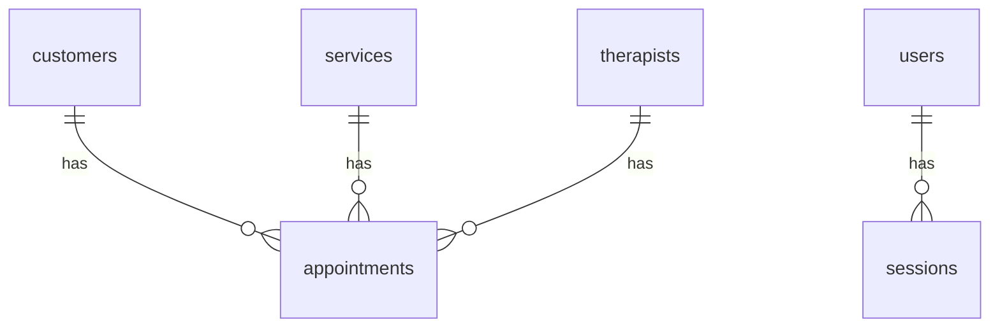

# Database schema

PostgreSQL, schema `spa` (`SPA_PG_SCHEMA`). Generated by `python tools/schema_doc.py` from the live catalog -
do not edit by hand; change a `migrations/NNN_*.sql` file and regenerate. Raw DDL: [`sql/schema.sql`](../sql/schema.sql).

## Relationships

| Table | Purpose |
|---|---|
| [`appointments`](#appointments) | One booking of one customer with one therapist for one service. Completed appointments drive revenue and incentive. |
| [`customers`](#customers) | Spa clients, created by onboarding or by hand. |
| [`services`](#services) | Price list of treatments. Editing a price affects future bookings only. |
| [`sessions`](#sessions) | Login sessions as opaque bearer tokens. Only the SHA-256 fingerprint of a token is stored, so a database leak cannot be replayed. |
| [`therapists`](#therapists) | Staff who perform services and are paid on payslips. Never deleted, only set inactive, so past payslips stay reproducible. |
| [`users`](#users) | Staff logins. Role admin = everything; staff = customers, onboarding, appointments. |

## appointments

One booking of one customer with one therapist for one service. Completed appointments drive revenue and incentive.

| Column | Type | Null | Default | Description |
|---|---|---|---|---|
| `id` | bigint | no | identity | Surrogate key. |
| `customer_id` | bigint | no |  | Who is being treated. Customers are never deleted, so history stays intact. |
| `therapist_id` | bigint | no |  | Who performs it; also the key of the no-overlap constraint. |
| `service_id` | bigint | no |  | What is performed. |
| `start_at` | timestamp without time zone | no |  | Spa-local wall-clock time (no time zone). |
| `duration_min` | integer | no |  | Copied from the service at booking time. |
| `end_at` | timestamp without time zone | yes | generated: `(start_at + make_interval(mins => duration_min))` | Generated: start_at + duration_min. Used by the no-overlap constraint. |
| `price` | numeric(12,2) | no |  | Amount agreed at booking in INR (list price unless overridden). Frozen: later price edits never change it. Payroll uses this. |
| `status` | text | no | `'booked'::text` | booked -> completed / cancelled / no_show. Only completed counts for revenue and incentive; only booked can be edited. |
| `notes` | text | yes |  | Free-text note for this visit. |
| `created_at` | timestamp with time zone | no | `now()` | When it was booked. |
| `updated_at` | timestamp with time zone | no | `now()` | Last reschedule or status change. |

**Constraints**

- Check `appointments_duration_min_check`: `CHECK ((duration_min > 0))`
- Check `appointments_price_check`: `CHECK ((price >= (0)::numeric))`
- Check `appointments_status_check`: `CHECK ((status = ANY (ARRAY['booked'::text, 'completed'::text, 'cancelled'::text, 'no_show'::text])))`
- Foreign key `appointments_customer_id_fkey`: `FOREIGN KEY (customer_id) REFERENCES customers(id)`
- Foreign key `appointments_service_id_fkey`: `FOREIGN KEY (service_id) REFERENCES services(id)`
- Foreign key `appointments_therapist_id_fkey`: `FOREIGN KEY (therapist_id) REFERENCES therapists(id)`
- Primary key `appointments_pkey`: `PRIMARY KEY (id)`
- Exclusion `appointments_no_overlap`: `EXCLUDE USING gist (therapist_id WITH =, tsrange(start_at, end_at) WITH &&) WHERE ((status = ANY (ARRAY['booked'::text, 'completed'::text])))` - A therapist cannot have two booked/completed appointments whose time ranges overlap (back-to-back is allowed). Enforced by the database so concurrent requests cannot double-book.

**Indexes**

- `appointments_customer_idx`: `CREATE INDEX appointments_customer_idx ON appointments USING btree (customer_id, start_at DESC)`
- `appointments_no_overlap`: `CREATE INDEX appointments_no_overlap ON appointments USING gist (therapist_id, tsrange(start_at, end_at)) WHERE (status = ANY (ARRAY['booked'::text, 'completed'::text]))`
- `appointments_start_idx`: `CREATE INDEX appointments_start_idx ON appointments USING btree (start_at)`
- `appointments_therapist_idx`: `CREATE INDEX appointments_therapist_idx ON appointments USING btree (therapist_id, start_at)`

## customers

Spa clients, created by onboarding or by hand.

| Column | Type | Null | Default | Description |
|---|---|---|---|---|
| `id` | bigint | no | identity | Surrogate key. |
| `name` | text | no |  | Full name; must not be blank. |
| `phone` | text | no |  | Unique across customers (customers_phone_key); how reception finds a returning client. |
| `email` | text | yes |  | Optional contact email. |
| `gender` | text | yes |  | Free text; the UI offers Female, Male, Other. |
| `dob` | date | yes |  | Date of birth (optional). |
| `address` | text | yes |  | Optional postal address. |
| `notes` | text | yes |  | Allergies, skin type, preferences. |
| `created_at` | timestamp with time zone | no | `now()` | Onboarding time; the "new customers" report counts by it in the spa time zone. |
| `updated_at` | timestamp with time zone | no | `now()` | Last edit. |

**Constraints**

- Check `customers_name_check`: `CHECK ((length(btrim(name)) > 0))`
- Primary key `customers_pkey`: `PRIMARY KEY (id)`
- Unique `customers_phone_key`: `UNIQUE (phone)`

**Indexes**

- `customers_name_idx`: `CREATE INDEX customers_name_idx ON customers USING btree (lower(name))`
- `customers_phone_key`: `CREATE UNIQUE INDEX customers_phone_key ON customers USING btree (phone)`

## services

Price list of treatments. Editing a price affects future bookings only.

| Column | Type | Null | Default | Description |
|---|---|---|---|---|
| `id` | bigint | no | identity | Surrogate key. |
| `name` | text | no |  | Treatment name; unique ignoring case (services_name_key). |
| `price` | numeric(12,2) | no |  | List price in INR, copied onto an appointment when it is booked. |
| `duration_min` | integer | no | `60` | Minutes a booking blocks on the therapist's calendar. |
| `is_active` | boolean | no | `true` | Inactive services cannot be booked; history keeps pointing at them. |

**Constraints**

- Check `services_duration_min_check`: `CHECK ((duration_min > 0))`
- Check `services_name_check`: `CHECK ((length(btrim(name)) > 0))`
- Check `services_price_check`: `CHECK ((price >= (0)::numeric))`
- Primary key `services_pkey`: `PRIMARY KEY (id)`

**Indexes**

- `services_name_key`: `CREATE UNIQUE INDEX services_name_key ON services USING btree (lower(name))`

## sessions

Login sessions as opaque bearer tokens. Only the SHA-256 fingerprint of a token is stored, so a database leak cannot be replayed.

| Column | Type | Null | Default | Description |
|---|---|---|---|---|
| `token_hash` | text | no |  | SHA-256 hex of the token handed to the browser. |
| `user_id` | bigint | no |  | Owner of the session; deleting the user deletes their sessions. |
| `created_at` | timestamp with time zone | no | `now()` | When the user signed in. |
| `expires_at` | timestamp with time zone | no |  | Sessions last 12 hours; expired rows are swept at the next login. |

**Constraints**

- Foreign key `sessions_user_id_fkey`: `FOREIGN KEY (user_id) REFERENCES users(id) ON DELETE CASCADE`
- Primary key `sessions_pkey`: `PRIMARY KEY (token_hash)`

**Indexes**

- `sessions_expires_idx`: `CREATE INDEX sessions_expires_idx ON sessions USING btree (expires_at)`
- `sessions_user_idx`: `CREATE INDEX sessions_user_idx ON sessions USING btree (user_id)`

## therapists

Staff who perform services and are paid on payslips. Never deleted, only set inactive, so past payslips stay reproducible.

| Column | Type | Null | Default | Description |
|---|---|---|---|---|
| `id` | bigint | no | identity | Surrogate key. |
| `name` | text | no |  | Name shown on bookings and printed on the payslip. |
| `phone` | text | yes |  | Optional contact number. |
| `fixed_salary` | numeric(12,2) | no | `0` | Monthly fixed pay in INR; the base of every payslip. |
| `incentive_percent` | numeric(5,2) | no | `0` | Percent (0-100) of the price of the therapist's completed appointments in a month paid on top of the salary. |
| `is_active` | boolean | no | `true` | Inactive therapists cannot be booked and drop out of the monthly payroll list. |
| `joined_on` | date | yes |  | Optional joining date. |
| `created_at` | timestamp with time zone | no | `now()` | When the record was added. |

**Constraints**

- Check `therapists_fixed_salary_check`: `CHECK ((fixed_salary >= (0)::numeric))`
- Check `therapists_incentive_percent_check`: `CHECK (((incentive_percent >= (0)::numeric) AND (incentive_percent <= (100)::numeric)))`
- Check `therapists_name_check`: `CHECK ((length(btrim(name)) > 0))`
- Primary key `therapists_pkey`: `PRIMARY KEY (id)`

## users

Staff logins. Role admin = everything; staff = customers, onboarding, appointments.

| Column | Type | Null | Default | Description |
|---|---|---|---|---|
| `id` | bigint | no | identity | Surrogate key. |
| `username` | text | no |  | Login name, at least 3 characters; unique ignoring case (users_username_key). |
| `password_hash` | text | no |  | PBKDF2-SHA256 hash "pbkdf2$iterations$salt$hash"; the password itself is never stored. |
| `role` | text | no | `'staff'::text` | admin or staff. |
| `is_active` | boolean | no | `true` | False blocks login and ends all sessions immediately; accounts are deactivated, never deleted. |
| `created_at` | timestamp with time zone | no | `now()` | When the account was created. |

**Constraints**

- Check `users_role_check`: `CHECK ((role = ANY (ARRAY['admin'::text, 'staff'::text])))`
- Check `users_username_check`: `CHECK ((length(btrim(username)) >= 3))`
- Primary key `users_pkey`: `PRIMARY KEY (id)`

**Indexes**

- `users_username_key`: `CREATE UNIQUE INDEX users_username_key ON users USING btree (lower(username))`
